# MFGA — Make Facebook Great Again

**Facebook, the way it looked in 2010 — and a News Feed with only your friends, groups and pages.**
No ads. No "Suggested for you". No reels, no stories tray, no People You May Know.

<table>
  <tr>
    <th width="50%">Facebook, February 2010</th>
    <th width="50%">With MFGA, on a test copy of today's facebook.com</th>
  </tr>
  <tr>
    <td valign="top">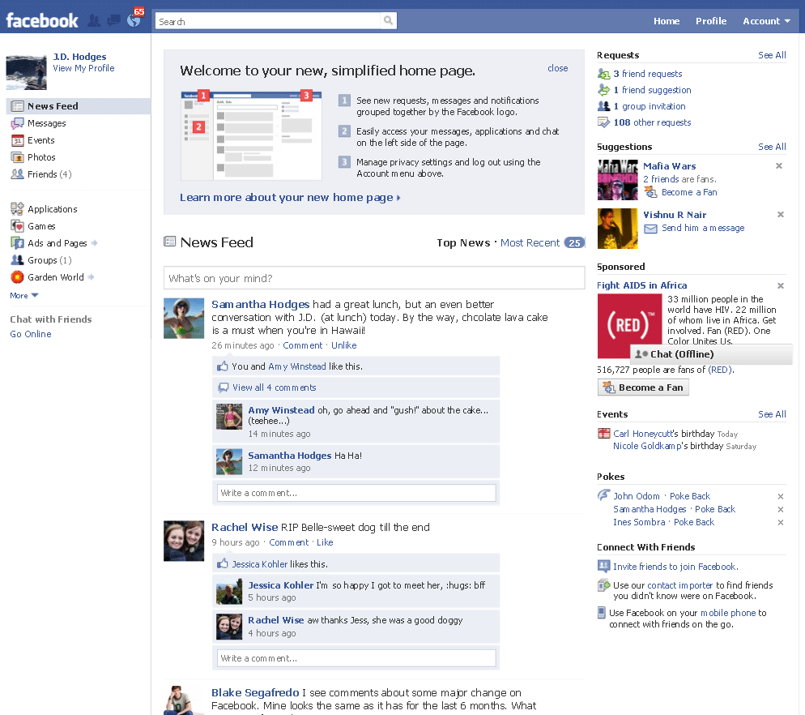</td>
    <td valign="top">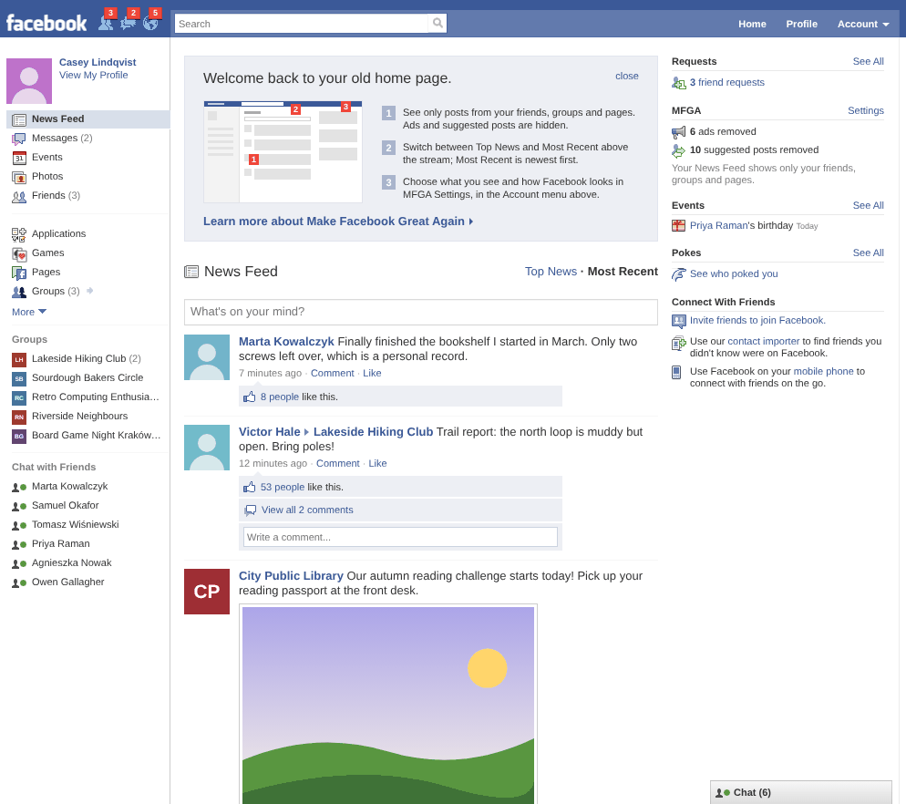</td>
  </tr>
</table>

The 2010 picture is a real screenshot of J.D. Hodges' home page, from his post
[The new facebook (Feb 2010 edition)](https://www.jdhodges.com/blog/the-new-facebook-feb-2010-edition/).
Every other picture here comes from the project's test copy of facebook.com, the one its browser tests
run against: every person, group, page and ad in them is made up.

**[Install](#install)** · [Settings](#settings) · [How it works](#how-it-works-and-why-it-is-safe) · [Limits](#limits)

MFGA is a browser extension (Chrome, Edge, Firefox) and a Tampermonkey userscript. It puts the
February-2010 Facebook back on top of today's facebook.com:

* the **2010 blue bar** with the old `facebook` wordmark, the three jewels (friend requests, messages,
  notifications) with their red counters, the search box and **Home · Profile · Account ▾**;
* the **left column** — your picture, *News Feed, Messages, Events, Photos, Friends*, *Applications,
  Games, Pages, Groups*, your groups and pages, and *Chat with Friends*;
* the **right column** — *Requests*, *Events* (today's birthdays), *Pokes*, *Connect With Friends*, and
  an MFGA box where the ads used to be, counting what was removed;
* **2010 stories** — 50px square pictures, the bold blue name followed by the post, "26 minutes ago ·
  Comment · Like", the light-blue box with "You and 3 others like this.", comments and "Write a
  comment...";
* Facebook's own icons, cut from its December 2009 and February 2012 sprite sheets and from the 2010
  screenshot above, a few recoloured to their 2010 colours;
* English and Polish, following Facebook's 2010 Polish wording (Aktualności, Najnowsze, Lubię to!…).

## The News Feed you actually wanted

Facebook 2026 has chronological feeds hidden behind URLs like
`facebook.com/?filter=friends&sk=h_chr` (also `groups`, `pages`, `favorites`) — but only one at a
time, and still with ads in between.

MFGA's **Most Recent** feed asks Facebook for all four, one after another (so the first page takes a few
seconds), exactly the way Facebook's own page asks for one of them. It merges them by time, removes
duplicates (a friend's post in a group shows up once), and drops every ad and suggestion before anything
is drawn. Any of the four can be switched off in the settings, as long as one stays on. **Top News** shows
Facebook's ranked feed, cleaned the same way.

<table>
  <tr>
    <th width="50%">Facebook today (test copy)</th>
    <th width="50%">With MFGA</th>
  </tr>
  <tr>
    <td valign="top">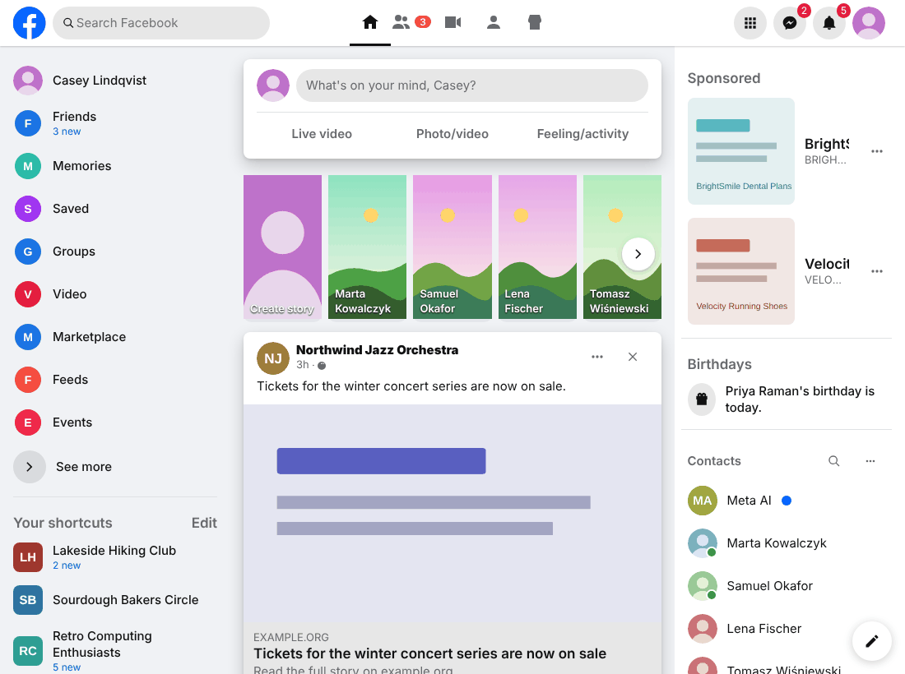</td>
    <td valign="top">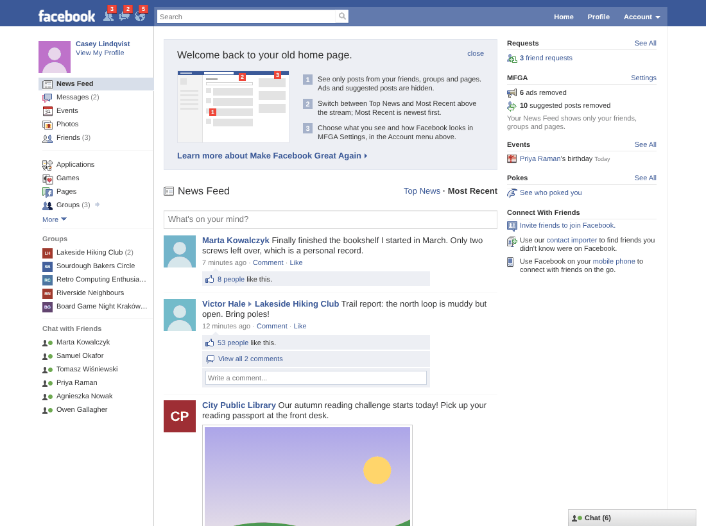</td>
  </tr>
</table>

Older posts load with the 2010 **Older Posts** button (or automatically as you scroll, if you prefer).
A blue count next to *Most Recent* says how many stories are new since you last looked. Open a photo or
a profile from the feed and press Back: you are where you left off, with the same stories.

The combined feed does not depend on the 2010 look: switch the 2010 layout off and Home keeps Facebook's
2026 page around MFGA's feed (and loses the right column's ads).

## A closer look

<table>
  <tr>
    <td width="50%" valign="top">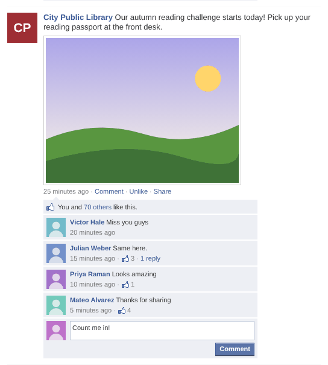</td>
    <td width="50%" valign="top">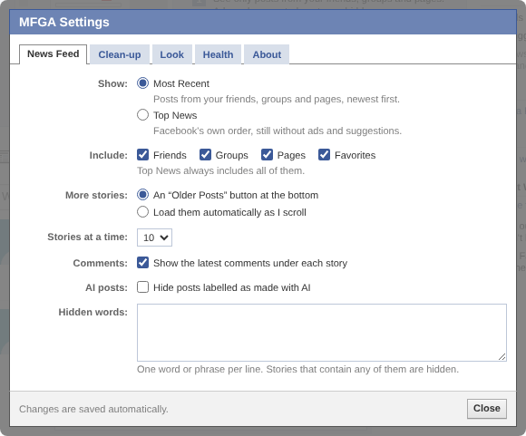</td>
  </tr>
  <tr>
    <td><b>Like, comment and read comments</b> in the stream itself, with Facebook's own requests.</td>
    <td><b>Account ▾ → MFGA Settings…</b> — what you see and how it looks.</td>
  </tr>
  <tr>
    <td valign="top">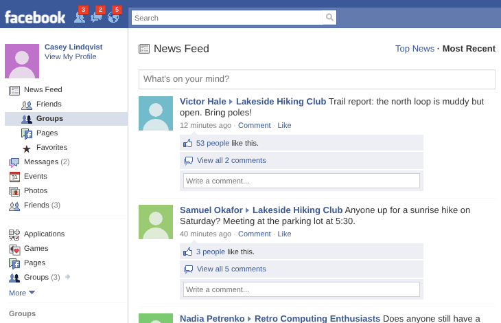</td>
    <td valign="top">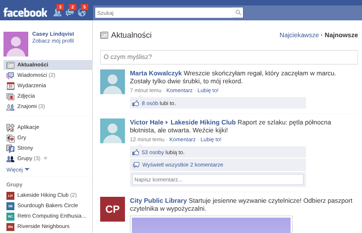</td>
  </tr>
  <tr>
    <td><b>One source at a time</b>: Friends, Groups, Pages or Favorites, under News Feed.</td>
    <td><b>Po polsku</b>, in Facebook's own 2010 Polish wording.</td>
  </tr>
  <tr>
    <td valign="top">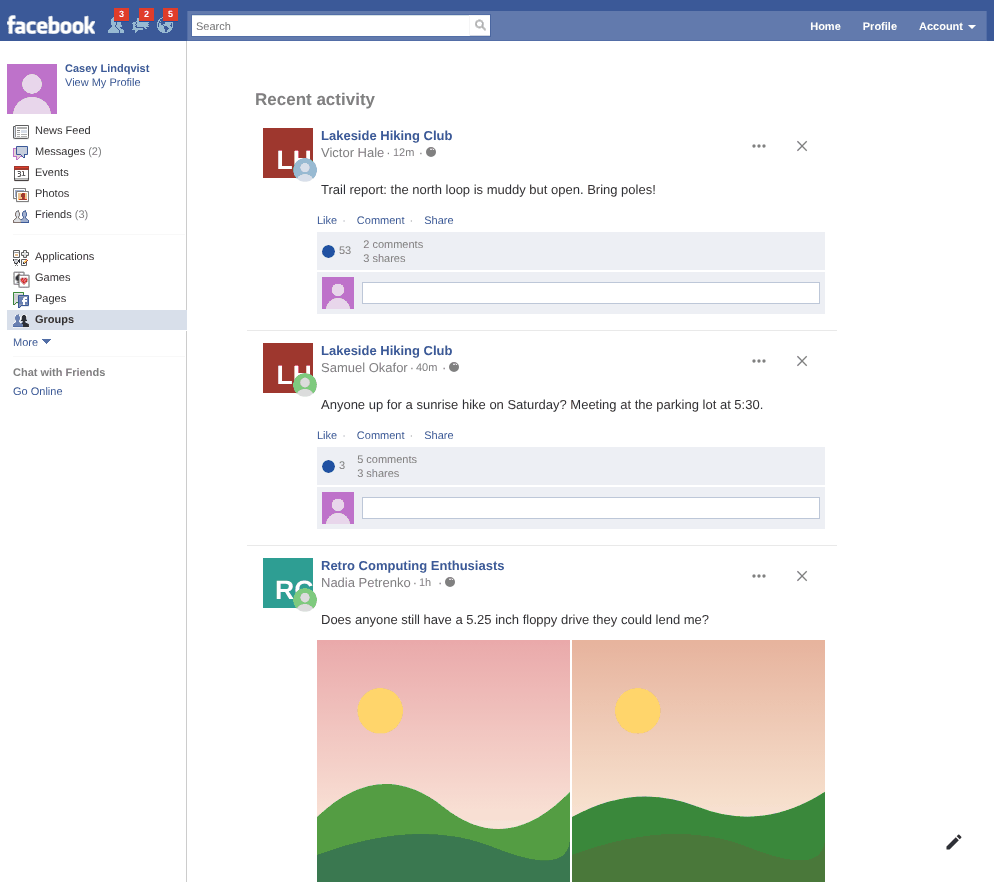</td>
    <td valign="top">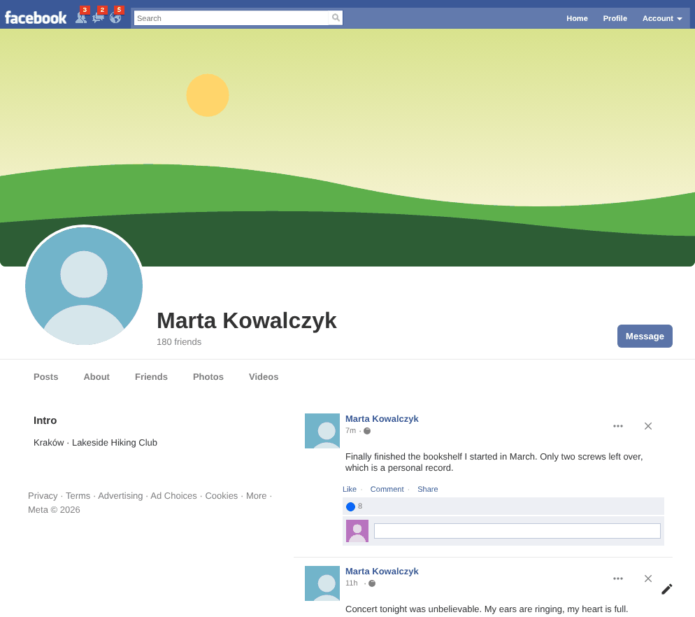</td>
  </tr>
  <tr>
    <td><b>Facebook's groups feed</b> gets the 2010 left column; its posts are cleaned and get the 2010 look.</td>
    <td><b>Other pages</b>, like profiles, keep Facebook's layout under the 2010 bar, in 2010 colours.</td>
  </tr>
  <tr>
    <td colspan="2">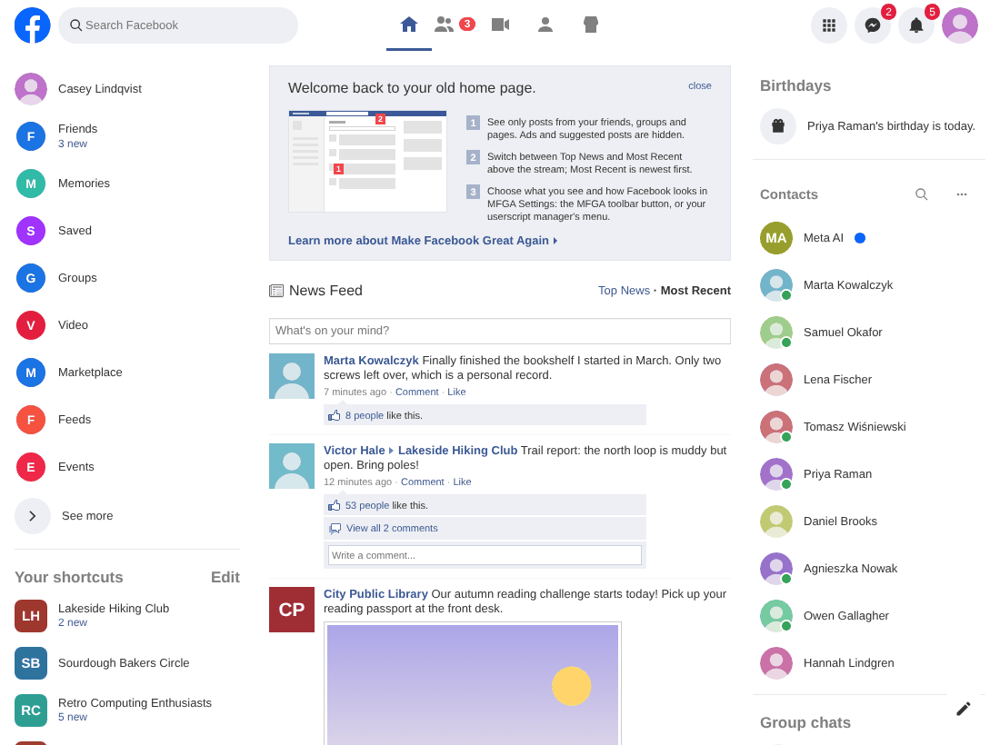</td>
  </tr>
  <tr>
    <td colspan="2"><b>Just the feed</b>: with the 2010 layout off, MFGA's feed sits in today's Facebook page.</td>
  </tr>
</table>

<sub>The screenshots come from the userscript build on the test copy of facebook.com that the browser tests
use; regenerate them with `npm run build && npm run screenshots`. They were taken on Linux, which has neither
Lucida Grande nor Tahoma, so their text is in Liberation Sans (an Arial look-alike) rather than the 2010
picture's Tahoma.</sub>

## Install

### Chrome / Edge / Brave

1. Download `dist/mfga-chrome.zip` from this repository and unzip it (or clone the repository).
2. Open `chrome://extensions`, switch on **Developer mode** (top right).
3. Click **Load unpacked** and pick the unzipped folder (the one with `manifest.json`, i.e. `dist/chrome`).
4. Open facebook.com. The puzzle-piece menu → MFGA (the Like-thumb icon) opens the settings.

### Firefox (128 or newer)

* For a quick try: `about:debugging#/runtime/this-firefox` → **Load Temporary Add-on…** → pick
  `dist/firefox/manifest.json` (it stays until Firefox restarts).
* Permanently: install the signed build from addons.mozilla.org once published, or on Firefox
  Developer Edition / Nightly set `xpinstall.signatures.required` to `false` and install
  `dist/mfga-firefox.zip`.
* Firefox asks for permission to read facebook.com — allow it (MFGA does nothing without it).

### Tampermonkey (or Violentmonkey)

1. Install [Tampermonkey](https://www.tampermonkey.net/).
2. Open [`dist/mfga.user.js`](https://raw.githubusercontent.com/pawel-mazurkiewicz/mfga/main/dist/mfga.user.js)
   and click **Install**. Updates arrive automatically from the same URL.
3. Chrome 138+: in `chrome://extensions` → Tampermonkey → **Details**, switch on **Allow User Scripts**.
4. Recommended: Tampermonkey → Settings (Advanced) → *Content Script API* → **UserScripts API Dynamic**.
   With the default, Tampermonkey starts scripts a moment late and you may see 2026 Facebook flash
   before the 2010 look appears.

The extension is the most robust option: it starts before Facebook does, its code runs in the
extension's own isolated world apart from a small page helper (the userscript runs inside Facebook's
page, as Tampermonkey runs scripts by default), and it learns the exact request format Facebook is
using today by watching Facebook's own requests (see *How it works*).

To switch MFGA off, turn the extension off in the browser's extensions page, or pick **Turn MFGA off
(back to 2026 Facebook)** in the userscript manager's menu.

## Settings

Click **Account ▾ → MFGA Settings…** in the blue bar, **Settings** in the right column's MFGA box, or the
toolbar button / userscript menu. Changes are saved as you make them.

* **News Feed** — Most Recent or Top News; which sources Most Recent merges (Friends, Groups, Pages,
  Favorites; at least one); an Older Posts button or loading as you scroll; stories at a time; the latest
  comments under each story; hiding posts labelled as made with AI; hidden words.
* **Clean-up** — what to hide wherever Facebook draws the feed itself (the groups feed, groups, search,
  and Home when MFGA cannot build its own News Feed): sponsored posts, suggested posts and
  "Follow"/"Join" suggestions, People You May Know, reels, stories, suggested groups, memories, Meta AI.
* **Look** — the 2010 layout (blue bar, left column, right column and footer), keeping the blue bar at
  the top while scrolling, the right column, the chat tab, the welcome box, 2010 colours and fonts on
  every Facebook page, the 2010 look for posts that Facebook draws itself, Lucida Grande or Tahoma, and
  the language.
* **Health** — what MFGA found on this page and any errors, with **Refresh**, **Reset settings** and
  **Export report** for bug reports. The exported report holds only counts and internal names: no posts,
  people, links or ids. Under *Advanced*: diagnostic messages in the browser console; whether MFGA may
  use its small page helper (it asks Facebook's own module registry for request ids and tokens, and moves
  between pages without reloading; without it MFGA relies on what it reads and learns, and some links
  reload the page); and stopping all requests when Facebook asks for a security check.
* **About** — the version, links to this repository and its issues, and credits.

## How it works (and why it is safe)

Facebook 2026 actively looks for ad blockers: it checks whether `JSON.parse`, `XMLHttpRequest` and
friends were modified and looks for extension code in error stack traces. **MFGA changes none of
Facebook's code**: it wraps or replaces no function of the page and never moves or removes Facebook's
elements. It only adds its own elements, attributes and stylesheet. It:

1. **reads** the data Facebook embeds in the page (the security tokens and the exact feed query
   Facebook preloads for you) — the same inline JSON Facebook's own scripts read;
2. **asks** Facebook's own `/api/graphql/` endpoint for the chronological feeds, from your browser, with
   your session — one request at a time, 1.5 to 2.25 seconds apart, and none while the tab is in the
   background. It asks when you open the feed, press *Older Posts* or scroll to the end (with automatic
   loading on), open a story's comments, like or comment, and for the comment previews under stories;
3. **filters** the answers: anything carrying Facebook's `SponsoredData`, a sponsored category,
   a "Follow"/"Join" suggestion, a recommendation context or a non-post unit (reels rows, People You
   May Know, stories trays, promotions…) is dropped;
4. **draws** the result in 2010 style, and **hides** Facebook's own chrome and feed with a
   stylesheet. Dialogs (photos, the post composer, chat windows, menus) are Facebook's own and keep
   working.

Likes and comments you make in MFGA's feed are sent with Facebook's own like and comment requests. If
Facebook refuses one (for example because it changed a request format), MFGA undoes it and offers a link
that opens the post on Facebook. **Share** opens the post on Facebook, and *What's on your mind?* opens
Facebook's own composer. Comment previews under stories are rationed (a few a minute, only for stories
you stop on), and repeated failures pause MFGA's requests for a few minutes rather than retrying.

Everything happens in your browser, and MFGA talks to nobody but facebook.com. It keeps these in the
extension's (or userscript manager's) storage:

* your settings;
* your name, picture, groups, Pages, chat contacts and birthdays as Facebook last showed them, so the
  2010 columns can be drawn on pages where Facebook leaves them out — deleted when a logged-out Facebook
  page loads;
* the time of the newest story you have seen, for the count of new stories;
* the request formats MFGA learns (which queries Facebook uses, and with what settings), without post
  ids or texts.

If your userscript manager has no storage of its own, only the settings (without your hidden words) are
kept, in facebook.com's local storage, where Facebook's scripts can read them. After you log out, nothing
of your account is shown.

If Facebook ever asks you to verify your account, MFGA stops all of its own requests (in every tab, for
6 hours, reloads included), gives the home page back to Facebook and says why at the top of it.

## Limits

* Facebook changes constantly. MFGA has several independent ways to find what it needs and falls back
  to "Facebook as it is, minus the junk" when one stops working — check the **Health** tab and export a
  report into an issue if something looks off.
* Only Home is fully 2010. The groups feed gets the 2010 left column; other pages (profiles, groups,
  events, Marketplace…) keep Facebook's 2026 layout between the 2010 bar and footer, in 2010 colours.
* Hidden words apply to MFGA's own News Feed, not to feeds Facebook draws itself.
* Facebook's feed answers do not name the people who liked a post, so the 2010 line reads "8 people
  like this." rather than naming friends.
* Outside links in MFGA's feed go straight to the site, not through Facebook's `l.facebook.com`
  redirect: Facebook does not learn which links you open, but it cannot warn you about a malicious one
  at click time either. The link box shows the site name Facebook gives for the link, or its address
  when Facebook gives none.
* The extension always registers its page helper; with the helper switched off it stays idle.
* Lucida Grande and Tahoma are Windows/macOS fonts; on Linux the closest available font is used.
* Mobile (m.facebook.com and the apps) is not supported.

## Development

```sh
npm install                 # esbuild + playwright-core
npm run build               # dist/mfga.user.js, dist/chrome, dist/firefox, store zips
node scripts/build.mjs --watch   # rebuild on every change in src/ and platform/
npm test                    # unit tests (node:test)
npm run test:e2e            # browser tests against a fake facebook.com (after npm run build)
npm run check               # build, unit tests and browser tests
npm run screenshots         # docs/screenshots/ for this README (after npm run build)
npm run atlas               # icon atlas from assets/sprites and the 2010 screenshot (Python + Pillow)
```

The browser tests and screenshots drive a Chromium binary: `/opt/pw-browsers/chromium` by default, or the
one `MFGA_CHROMIUM` points to (for example `MFGA_CHROMIUM=/usr/bin/chromium npm run test:e2e`).

* `docs/ARCHITECTURE.md` — how the pieces fit, and the rules that keep MFGA invisible to Facebook.
* `docs/CONTRACTS.md` — the interfaces between the main modules, as planned when they were written.
* `docs/research/` — what we learned about 2026 Facebook (GraphQL protocol, feed and chrome DOM,
  userscript/extension platforms) and the exact 2010 design, with sources.

## Credits

* The icons are Facebook's own: most from the December 2009 and February 2012 sprite sheets, a few
  (the logo, the request and message jewels, the Games icon, the More arrow, the search glass) from the
  2010 screenshot. Facebook and
  its logos are trademarks of Meta Platforms, Inc. MFGA is an unofficial, non-commercial fan project, not
  affiliated with Meta.
* The February 2010 screenshot is J.D. Hodges', from
  [The new facebook (Feb 2010 edition)](https://www.jdhodges.com/blog/the-new-facebook-feb-2010-edition/).
* Ad-label translations build on zbluebugz's
  [FB - Clean my feeds](https://github.com/zbluebugz/facebook-clean-my-feeds) dictionary (MIT, per its
  userscript header).
* Research leaned on [webcleaner](https://github.com/pyxis3-ai/webcleaner),
  [uBlock Origin's filter lists](https://github.com/uBlockOrigin/uAssets), HushFacebookWeb and other
  open-source projects listed in `docs/research/`.

## License

MIT — see [LICENSE](LICENSE).
